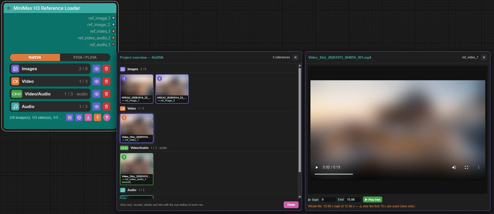

# MiniMax H3 Reference Loader

[](pyproject.toml)
[](#compatibility)
[](LICENSE)
[](#compatibility)

ComfyUI custom node that loads the references of the native **MiniMax H3 Reference to Video** node, picked in thumbnail galleries.

<p align="center">
  
</p>

- A switch at the top chooses the mode: **Ref2VA** (references for MiniMax H3 Reference to Video, the rows below) or **F2VA / FL2VA** (a **First frame** and an optional **Last frame**, images only, on the outputs `first_frame` and `last_frame` for MiniMax H3 Image to Video; without a last frame MiniMax does F2VA). Each mode keeps its own selection and outputs; switching back reconnects the wires of that mode when their target is still there and free.
- **Images** (up to 9), **Video** (up to 3), **Video/Audio** (up to 3 video soundtracks), **Audio** (up to 3).
- Click order sets the number: the first image clicked is `ref_image_1`, i.e. `<Picture 1>` in the prompt.
- **Video** gives the video frames on `ref_video_N`. **Video/Audio** picks videos too, but only their **soundtrack** is extracted: it is an **audio track** on `ref_video_audio_N`, counted with the audio tracks. The two lists are independent (pick the same video in both to get its frames and its sound). The **Audio** gallery also accepts videos: only their soundtrack goes out on `ref_audio_N`, as an independent audio track (not tied to `ref_video_N`), shown with a *🔊 sound only* badge and trimmable like any audio file; a video without soundtrack is refused.
- Note: MiniMax uses the audio track wired to `ref_video_audio_N` together with the reference video wired to `ref_video_N`. When both have a file, their output dots share a colour (pair 1 orange, 2 pink, 3 green).
- One output appears per selected file (at least one per type); wire the outputs in order (MiniMax numbers its inputs from 0: `ref_image_1` goes to `ref_image_0`, and so on). Double-click an output name to rename it. An output that disappears because the selection got smaller remembers its links and gets them back when it reappears, as long as the input downstream is still free (in memory only, not saved in the workflow).
- The eye button next to each row shows the selection in order (clicking an image, a video or an audio file also opens it in a preview window of the same size on the right): arrows move a reference, the trash on a thumbnail marks it, and **Delete** removes the marked ones (the following references move up, the last empty output is removed).
- The **overview** button (four squares, at the bottom) shows the whole selection of the mode shown in one window, a section per row (Images, Video, Video/Audio, Audio; or First frame and Last frame), with the number, output and ✂ badge of each file. Clicking a thumbnail opens it in the preview window on the right (image, video or audio with its player). The trim is shown and can be played (*Play trim*) but not changed there; reorder, delete and trim with the eye button of each row. Greyed out while the mode shown has no reference.
- **Trim** videos, video soundtracks and audio in that preview window: set the start and end (fields or current playback position), check with *Play trim*, or *Reset*. The file is never changed; only that part goes to the output (frames and sound). Trimmed files show a ✂ badge; the trim is saved in the configuration file as `"trim": [2.5, 8]`.
- The trash button next to the eye deletes **all** the references of its row, after a confirmation.
- The gear button sets a **root folder** for your rushes. In a gallery, **Root folder** is prefilled with it and its content is shown. **Subfolder** is a drop-down list of all the subfolders of the root folder, with the number of files of that type after each name; **(root folder)**, the default, shows the root folder itself. The magnifier of **Root folder** shows the root folder content and finds its subfolders again for the list; the magnifier of **Subfolder** shows the content of the chosen subfolder. A folder with one kind of files shows a single grid; a mixed folder shows a section per kind (Images, Video or Video/Audio, Audio). Only the files of the button that opened the gallery can be selected; the others are shown for information. Clicking an image or a video also shows it in a preview window on the right (image, or video with its player). Both magnifiers are greyed out without a root folder; Browse and Reload stay available. Reload goes back to the root folder when the gallery shows another folder (picked with Browse or typed). The chosen subfolder is remembered per type.
- The download button saves the configuration of the mode shown in its own `.json` file (one file per mode, never mixed): `REF2VA_minimax_config_yyyyMMdd-HHmmss.json` (root folder + the four lists) or `FL2VA_minimax_config_yyyyMMdd-HHmmss.json` (root folder + the two frames); the date and time in the name keep a new save from overwriting an older one. The button is greyed out while the mode shown has no reference (the root folder alone does not count). The file gives its type (`format`, `mode`), then the references:

  ```json
  {
    "format": "MiniMax H3 Reference Loader",
    "version": 1,
    "mode": "REF2VA",
    "root": "F:\\Rushs\\Project",
    "images": ["images\\a.png"],
    "videos": [{ "path": "videos\\shot.mp4", "trim": [5, 7] }],
    "video_audios": [{ "path": "videos\\shot.mp4" }],
    "audios": []
  }
  ```

  ```json
  {
    "format": "MiniMax H3 Reference Loader",
    "version": 1,
    "mode": "FL2VA",
    "root": "F:\\Rushs\\Project",
    "first_frame": "images\\start.png",
    "last_frame": null
  }
  ```

  Paths under the root folder are written relative to it; an empty group is `[]` or `null`.
- The upload button loads a `.json` file of the mode shown and sets its outputs (older `.txt` saves are no longer read); a file saved in the other mode is refused with a warning (switch mode first) and nothing is changed. It keeps its standard color while the mode shown has no reference and turns orange as soon as it has one (the root folder alone does not count), and then asks for a confirmation. The other mode and the mode switch are never changed; the root folder is taken from the file. Files missing on disk are still loaded and reported on the node.
- The **?** button opens the help: a menu of sections on the left (Quick start, Modes, Picking files, Selection, Trim, Overview, Save and load, Outputs, Limits), one section at a time on the right, a search field that filters the sections and highlights the words, and Previous / Next links (or the ← → keys). It reopens on the last section viewed. The help is in English or French: the globe button in its header opens the language list; by default it follows the ComfyUI language (then the browser's), and the choice is remembered. The search ignores accents and case.
- Videos are read at 24 fps, cut to 15 s and reduced to 768×1344 pixels at most; audio is cut to 15 s.

## MiniMax H3 Project node

A second node of this pack, **MiniMax H3 Project** (`loaders/minimax`), creates and picks project folders in the root folder of the Reference Loader:

- The Reference Loader has a **project** output, always its last output (in both modes): it gives its root folder (gear button). Wire it to the **project** input of the Project node.
- Click **+**: a window shows where the project goes and asks for the name. With a root folder in the Reference Loader, the project goes there. Without one (nothing wired, or empty root folder), you choose the projects folder (type it or Browse), with the fallback folder `ComfyUI/input/Projets` filled in; the folder chosen is then kept as the root folder of the wired Reference Loader, or by the Project node itself. The window warns when the folder does not exist yet (it is then created). **Create** makes the project folder with `00.Workflows`, `02.Models`, `04.Prompt`, `06.LoRA`, `08.Images`, `10.Son`, `12.Video`, `14.Video-Audio`, `40.Rush Videos` and `60.Rush Images`, plus `99.Project-Config` (configuration of the project, with its `Archives` folder; no row in the node).
- The top line reads **Project name:** with the drop-down list, a pencil button (rename the project folder, or move the whole project to another folder: the window shows the current and the new name or folder, and asks for a confirmation) and **+**.
- **Save** (wired Reference Loader) shows what it will do, asks for a confirmation, then copies the files of the Reference Loader into the project (Images, First and Last frame in `08.Images`, Video in `12.Video`, Video/Audio in `14.Video-Audio`, Audio in `10.Son`; a file already there is not copied again, another file with the same name becomes `name (2)`), makes the Reference Loader use the copies, saves the workflow, then writes `99.Project-Config/config_projets_<project>.json`: project name, mode, creation and modification dates, project folder, then every folder from `00.Workflows` to `60.Rush Images`, even empty (`Valide`, number of files, then each file with `Indice`, `Dossier`, `nom`, the `SHA256` for 00, 04, 08, 10, 12 and 14, the list and `trim` for the media, `Nodes` and `Links` for the workflows). The index of a media file is its number in the Reference Loader (elsewhere its rank by name): a file of 08, 10, 12 or 14 that the Reference Loader does not use stops the save and is listed. The previous configuration goes to `99.Project-Config/Archives` as `yyyyMMdd-HHmmss_config_projets_<project>.json` (never overwritten, no limit). The workflow of the project is `00.Workflows/workflows_<project>.json`; older names (`<project>.json`, `Project-Config.json`) are renamed by themselves, and renaming the project renames both files. In the configuration, `02.Models` and `06.LoRA` give the current index of their registry (`Valide` false and 0 without registry). Right after creating a project, a first save is offered. The references in the project follow a rename or a move.
- **Run record:** wire the final prompt text to the optional `text_prompt` input of the Project node. Each Run then writes `04.Prompt/yyyyMMdd_HHmmss_run.json` (date, project, mode, prompt, and the CFG, Steps and Seed read in the run itself: KSampler first, then CFGGuider, RandomNoise…; a linked value is followed through Get / Set, Reroute, value nodes, switches and Pixaroma Sliders, and a value computed during the run gives `null` with `cfg_from` / `steps_from` / `seed_from` naming its node); only the new files of a run count (a file already recorded by a previous run and older than the run, sent back by the cache of ComfyUI, is ignored; a file written during the run counts even if it takes the name of an old one), and a run without any new file or stopped without any file is not recorded; at the end of the run, its generated videos are copied to `40.Rush Videos` from the real path given by the save node (its own folder for Pixaroma Save Video or Video Helper Suite, otherwise the output folder) under the name of the JSON (`_02`… for the next ones); a video larger than 960x544 is reduced to fit in it (same proportions, H.264 .mp4, same frame rate, sound kept), a smaller one is copied as it is, and a video saved in `40.Rush Videos` itself is left alone; images are not copied (they stay in the folder of the save node); the JSON lists them all (`size` / `copy_size` for videos) with `status` done or error. The ComfyUI page must stay open until the run ends for the copy. Each output gets `kind` (video / image). Registries: at the end of a recorded run, `02.Models/yyyyMMdd_HHmmss_models.json` (entries `IndiceMODELS`: diffusion_model, text_encoder, vae) and `06.LoRA/yyyyMMdd_HHmmss_LoRA.json` (entries `IndiceLoRA`: `ListeName` LoRA01, LoRA02… with their strengths) get the set used by the run: an existing set keeps its index (`datemodifi` updated), a new or changed one gets the last index + 1 (`DernierIndice…`); `IndiceEnCours…` is the set of the last run; the run JSON keeps only `models: [{indiceMODELS}]` and `loras: [{indiceLoRA}]`. The JSON also gets `models` (diffusion_model, text_encoder, vae, loras with their strengths), read in the run: only the nodes upstream of the samplers and VAE decoders, following the chosen branch of a switch, with only the active LoRA of LoraManager / Power Lora Loader; a file name given by a link is followed up to the file name (for example a file-select node whose output N gives its field N); the run windows show them in two folding blocks, Models and LoRA (one open at a time, folded when another run is shown). The rows of 04.Prompt, 40.Rush Videos and 60.Rush Images show `Last run: dd/MM/yyyy hh:mm:ss | Runs: n` (no bell on these rows); clicking 04.Prompt opens the runs (filter All / Video / Image, list, Configuration with the folder of the original, Prompt, thumbnail), clicking 40 or 60 shows the videos (copies) or images (originals) named in the run JSONs, with the Configuration and Prompt of the picked one (a copy icon at the top left of the Prompt frame copies the text to the clipboard); a thumbnail opens in a Preview window. A green dot means the original is in its project folder (video in `40.Rush Videos`, image in `60.Rush Images`), a dark orange one that it is elsewhere: **Move to …** then copies it into the project, checks the copy (SHA256) and deletes the original (a video replaces its reduced copy, only one version kept); on an error the original is untouched, with Retry / Abandon (abandoned after 3 failed attempts).
- **Load** first compares every file with the configuration (SHA256), without changing anything; a missing or different file is looked for in the `Archives` of its folder (same SHA256, same name first). The window *Load the project* shows each folder with ✓ / ✗, `→ found in Archives` with an eye that opens the file in a *Preview* window next to it (image, video, sound; ✕, Escape or a click outside closes only the preview), a check box (checked) for 00.Workflows, 08.Images, 10.Son, 12.Video and 14.Video-Audio, the warning about the prompt in progress for 04.Prompt, and 02.Models, 06.LoRA, 40.Rush Videos and 60.Rush Images as information only. **Load** puts back the files found in Archives (a file already there under that name goes to Archives first) and fills the Reference Loader for the checked folders. A workflow with the same structure (nodes and links, by output and input name) replaces the current one; with another structure the current workflow is never replaced and the saved one opens in a new tab `name-copie` (the window lists the nodes and links in more or missing); with 00.Workflows unchecked, the media go to the Reference Loader of the current tab.
- The workflow is saved in `00.Workflows` (right when a project is created, then with the save button or the bell of that row). The bell is grey (never saved), orange (changes to save, also right after the first save) or green (saved, no change since; it turns orange on the next change of nodes, links or values, not when nodes are only moved). Clicking it lists the changes, asks whether to archive the previous workflow (moved to `00.Workflows/Archives` as `yyyyMMdd-HHmmss_name.json`, date of its last save; archives left in `00.Workflows` by older versions move there on their own, and the archives button lists that folder) and proposes the project name, which can be changed; the button reads Save (green) with Archive it and Overwrite (orange) with Overwrite, and the window stays open after saving until Close is clicked. With the project output wired to a Project node with a project picked, the gallery of the Reference Loader shows the selected folder above and, below a line, the matching folder of the project (Images: 08.Images, Video: 12.Video, Video/Audio: 14.Video-Audio, Audio: 10.Son) with its selection number always shown and the files ordered by that number; the check box under a selected project file (unchecked at first) marks it to replace: the next file picked above goes to a pool of pending replacements (the replaced file is locked and shows n → A); its number shows under a green ✓ that validates it, a red ✕ cancels one, Validate changes applies them all (each replaced file goes to Archives first, then each new file enters the project folder with its number: copied from the selected folder, moved when it comes from Archives, `_02`, `_03`… added if the name is taken, the same name kept when it replaces a file with that name); a coloured bar under the name marks duplicates (same SHA256) among the pending replacements and the project folder, one colour per group and Cancel changes puts everything back, both confirmed (a full selection shows a message saying so). Clear is greyed out with a project (the order of its files cannot be emptied at once), and the window is taller. When the Archives folder has files, a View archives button turns green and shows them above instead of the selected folder; clicking it again goes back. On closing, files added to an existing selection ask Add, Replace or Cancel (Cancel cancels all the changes made in the window, except replacements already validated, and closes it), and every file of that project folder no list uses anymore is moved (after a confirmation) to its Archives subfolder; nothing is deleted. Then every file of the list goes to that project folder (copied from elsewhere, moved from Archives, `_02` if the name is taken; trims follow). Only one checked file can wait for its replacement (the other boxes are greyed out); closing with it asks Cancel or Continue (it stays as it was, the pending replacements are applied). 08.Images, 10.Son, 12.Video and 14.Video-Audio follow the lists of the Reference Loader: a reference added or removed there shows a warning sign left of the folder and turns its bell orange; the bell also turns orange when the folder keeps files that no list of the Reference Loader uses anymore; clicking the bell lists the changes and Update copies the new files (the Reference Loader then uses the copies) and moves every unused file of the folder (removed references included) to its `Archives` subfolder, so it no longer shows in the gallery of the project; nothing is deleted. The row of those four folders shows `Use: n/x | Orphelins: m | In Archives: y` (n files of the folder used by the Reference Loader out of x, the most it accepts for the folder: 08.Images 9 in Ref2VA or 2 in FL2VA, 10.Son / 12.Video / 14.Video-Audio 3; m orphan files, without number and not archived yet, shown only while there are some; y files in `Archives`). Clicking the button of one of those four folders opens a view-only window (Close, Escape or a click outside closes it): its files in the order of the Reference Loader with their number (F / L for First / Last frame, files without number last), then a frame with the files of its `Archives` folder; both rows scroll sideways, and a click on a thumbnail opens it large in a Preview window. The `Archives` folder of those four folders is also read for duplicates (same SHA256, even when the folder itself is empty): a duplicates button then appears right of the bell. It opens a *Duplicates* window with one thumbnail per group (number of copies, check box); clicking a thumbnail shows all its copies below with their total size and the size freed. Files moved to the `Archives` folder of those four folders are named `yyyyMMdd_HHmmss_name.ext` (date of the archiving, `(2)`-like numbers removed, the next second when the name is taken; files already there are not renamed), and take their name back without the date when they leave Archives. One copy always stays in Archives (a dated name without `(x)`, then a name without `(2)` or `_02`, otherwise the oldest); after the deletion it is named `yyyyMMdd_HHmmss_name.ext` (its date kept, or the date of the file instead of the `(x)`). *Delete (x) file(s)* needs at least one box checked and asks Cancel, Move to Recycle Bin (Windows only) or Delete permanently; groups left without duplicates leave the window. This is not a workflow change: no configuration is written and the workflow bell ignores the content of those lists. A warning sign left of the 00.Workflows button shows that the workflow has changed (nodes, links, values) and is not saved yet; it goes away once saved. The row shows `Last save: dd/MM/yyyy at hh:mm:ss`; the button right of the bell opens an archived workflow in a new tab. At most 5 archives per project: with 5, the archives get a check box; Delete removes the checked ones and proposes the save, Cancel closes the window. In the bell window, Save with Archive it opens that list first; Overwrite saves directly.
- Under the list, one row per folder of the project, with its own icon and colour and a small bell (their actions will come later); greyed until a project is picked, the tooltip gives the folder path.
- Or pick an existing project in the drop-down list; a missing subfolder is created again. Change the root folder of the Reference Loader and the list follows.

## Compatibility

Works with the classic node design and with **Modern Node Design (Nodes 2.0)**: in both, output names can be renamed by double-click (or the right-click menu) and paired outputs share their colour.

Tested on Windows only. On Linux and macOS the Browse button is not available (type the folder path instead); everything else should work but is untested.

## Install

Copy this folder into `ComfyUI/custom_nodes/` and restart ComfyUI. No extra dependency (uses PyAV, Pillow and torch shipped with ComfyUI). The **Browse** button opens the Windows folder dialog; on other systems type or paste the folder path.

## Tests

```
python -m unittest discover -s tests -v
node --test tests/test_config_format.mjs tests/test_config_json.mjs tests/test_help_search.mjs tests/test_project_paths.mjs tests/test_workflow_diff.mjs
```

## Credits

- Thanks to **pixaroma** for [ComfyUI-Pixaroma](https://github.com/pixaroma/ComfyUI-Pixaroma): the interface of this node (buttons on the left, thumbnail gallery) is inspired by its *Load Images Folder* node, and the Windows folder dialog script is adapted from it (MIT License, see [LICENSE](LICENSE)).
- Built for the native **MiniMax H3** nodes of ComfyUI.

## License

Code and documentation: MIT, © 2026 marche-obscure. Images in `assets/` (if any) are all rights reserved. Third-party code: see the end of [LICENSE](LICENSE).
